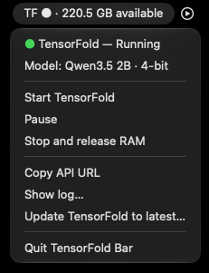

# TensorFold Bar

A macOS menu bar controller for [TensorFold](https://github.com/ashhart/TensorFold) on Apple Silicon.



## Controls

Opening TensorFold Bar automatically starts the saved model: it checks/downloads the checkpoint, then starts the local server. Pause, Stop, and manual Start remain available in the menu. Opening the app with a newly selected model can start a large download if its weights are not cached.

- Model: choose a checkpoint from the submenu. Stop the server before switching; the selected repository is remembered.
- Start: download/check the selected checkpoint, then launch its local server. The starter Qwen3.5-2B checkpoint is revision-pinned; other models use their repository's current default revision. Large models can require over 100 GB of downloads and substantial loading time.
- Pause / Resume: suspend or resume the server process. Pausing retains model memory and pauses requests.
- Stop: terminate the server and release its memory.
- Available RAM: estimated reclaimable memory (free + inactive + speculative pages), refreshed every three seconds. This is an estimate, not Activity Monitor's memory pressure metric.
- Update TensorFold to latest: available when stopped; fetch the latest upstream Apple Silicon release, verify its published SHA-256 checksum, and replace the bundled engine.
- Copy API URL and Show log.
- Benchmark: sends one local request for up to the selected output token limit. Choose 32–4,096 tokens from the Output tokens submenu (default: 64); the choice is remembered. While measuring, the menu says “Benchmark running…”; result rows appear only after successful completion. Results include overall output tokens/second, elapsed seconds, prefill speed, and time to first token. Prefill and first-token times come from TensorFold's per-response `tensorfold.prefill_seconds` and `tensorfold.time_to_first_token` fields. Prefill speed uses uncached prompt tokens; fully cached prompts are labeled, and missing timing/count fields show unavailable. Overall speed includes prompt processing and generation. This is an end-to-end measurement; cached prompts affect results. Results stay local. Stop or Quit cancels the benchmark.

API URL: `http://127.0.0.1:8080/v1`; model name: `local-model`.
Logs: `~/Library/Logs/TensorFoldBar.log`.

## Model choices

| Menu choice | Checkpoint | Scope |
| --- | --- | --- |
| Qwen3.5 2B, 4-bit | `mlx-community/Qwen3.5-2B-MLX-4bit` | Existing starter model, pinned revision |
| Qwen3.8 27B, 4-bit | `TensorFold/Qwen3.8-27B-MLX-4bit` | Native Metal |
| Qwen3.8 Flash Next, 4-bit | `TensorFold/Qwen3.8-Flash-Next-MLX-4bit-MTP` | Native Metal, includes MTP |
| Qwen3.8 Flash Next, 6-bit | `TensorFold/Qwen3.8-Flash-Next-MLX-6bit-MTP` | Native Metal, M5 Ultra checked upstream |
| GLM-5.3 Flash, 4-bit | `TensorFold/GLM-5.3-Flash-MLX-4bit-MTP` | Experimental on a single Mac; upstream qualifies two M5 Ultras |
| DeepSeek Flash | Informational menu entry | Native release does not yet serve DeepSeek; the old Python 0.6.6 recipe uses a different engine |

All selectable models serve as `local-model` at the same API URL with an 8,192-token context, one stream, and thinking off. The benchmark uses this alias as well. Model choices do not automatically download optional external drafters. Default TensorFold memory admission limits are preserved; choosing a larger model does not override them. GLM's single-Mac path may refuse to load and has not been validated by this app.

Support references: [upstream supported models](https://github.com/ashhart/TensorFold/blob/main/docs/supported-models.md), [Mac runbook](https://github.com/ashhart/TensorFold/blob/main/RUNBOOK.md), and [DeepSeek recipe and engine distinction](https://github.com/ashhart/TensorFold/blob/main/docs/recipes/deepseek-v4-flash.md). These are the documented limits when the picker was added, not a guarantee for future releases.

## Build

Requires an Apple Silicon Mac, macOS Cocoa/AppleScript support, and the system Ruby and command-line utilities. No Swift compiler is needed.

```bash
bash build.sh
open "dist/TensorFold Bar.app"
```

Building downloads the latest TensorFold runtime from its upstream GitHub release. To bundle an already extracted runtime instead:

```bash
TENSORFOLD_RUNTIME="/absolute/path/to/tensorfold-1.3.2-macos-arm64" bash build.sh
```

Move the resulting app to a writable location. Updates modify its bundled runtime; managed or read-only installations may prevent updates. The build uses local ad hoc signing, not Apple notarization.

## Status

Initial prototype. AppleScript source compiles, but launch and server controls still need validation on the target Mac. “Running” currently means the server process started; the model may still be loading. Updates require stopping the server first. Closing the app terminates the server it owns.

TensorFold and downloaded models retain their upstream licenses. Model weights and third-party runtime binaries are not included in this source repository.
